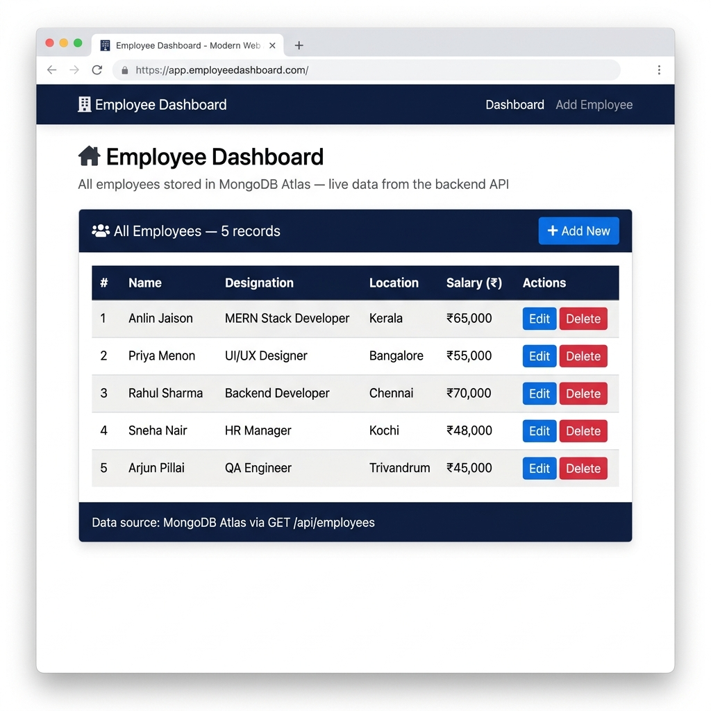
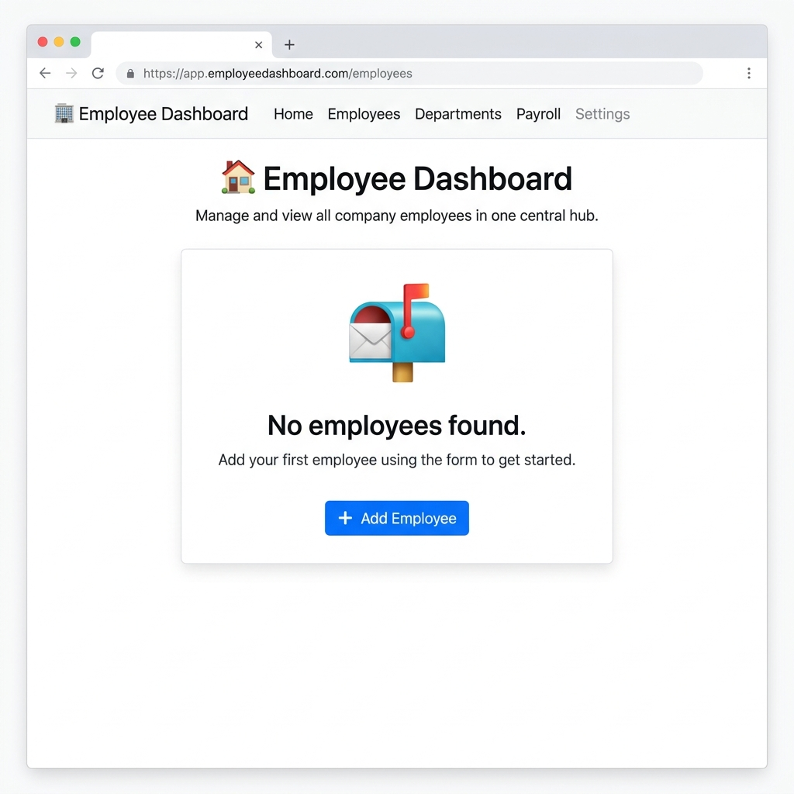
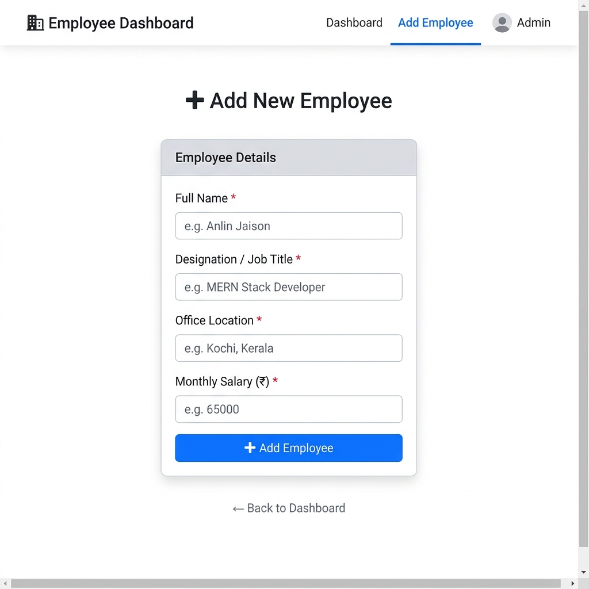
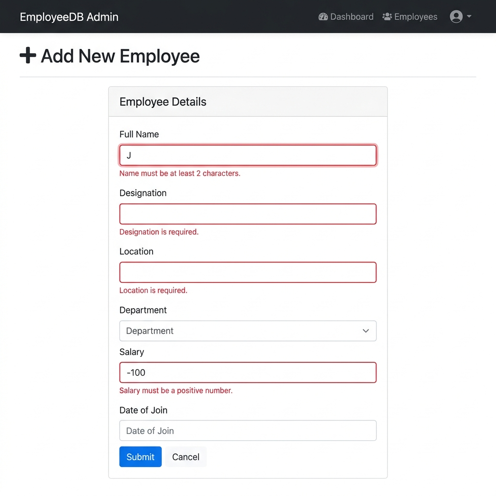
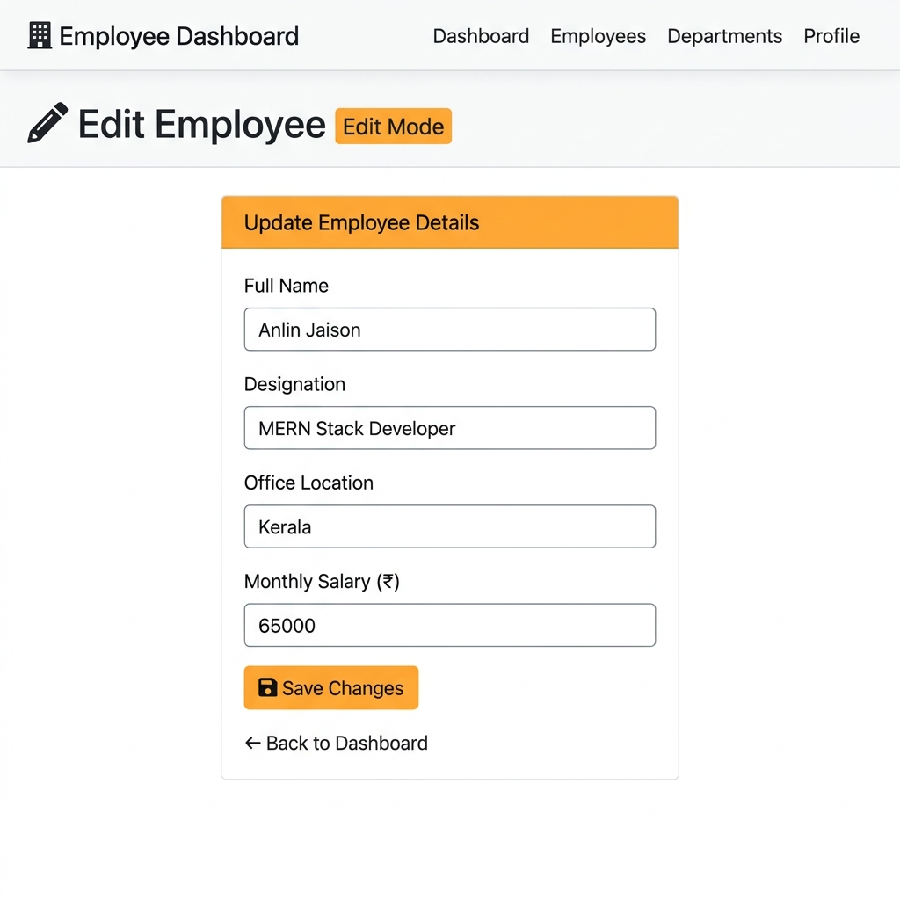

# 🏢 Employee Dashboard — Full Stack MERN App

> A complete Employee Management System built with **MongoDB · Express · React · Node.js**

**GitHub Repository:** https://github.com/anlinjaison/employee__dashboard  
**Hosted Application:** *(Deploy to Render using steps below — see [Deployment](#deployment) section)*

[](https://render.com/deploy?repo=https://github.com/anlinjaison/employee__dashboard)

---

## 📋 Table of Contents

- [Overview](#overview)
- [Problem Statement](#problem-statement)
- [Features](#features)
- [Tech Stack](#tech-stack)
- [Architecture](#architecture)
- [Folder Structure](#folder-structure)
- [Prerequisites](#prerequisites)
- [Installation](#installation)
- [Environment Variables](#environment-variables)
- [Running Locally](#running-locally)
- [Production Build](#production-build)
- [API Endpoints](#api-endpoints)
- [Screenshots](#screenshots)
- [Deployment](#deployment)
- [Testing](#testing)
- [Known Limitations](#known-limitations)
- [Future Improvements](#future-improvements)

---

## Overview

The Employee Dashboard is a full-stack web application that allows an HR administrator to manage employee records through a clean, responsive web interface. All data is stored persistently in MongoDB Atlas and served through a Node.js/Express REST API consumed by a React frontend.

---

## Problem Statement

Small organisations often manage employee records in spreadsheets, leading to data inconsistency, no real-time access, and no input validation. This app provides a centralised, validated, and persistent solution.

---

## Features

| Feature | Description |
|---------|-------------|
| ➕ Add Employee | Fill in a form to save a new employee to MongoDB |
| 👀 View All Employees | Dashboard table showing all employees from the database |
| ✏️ Edit Employee | Pre-filled form to update an existing record |
| 🗑️ Delete Employee | Remove a record with a confirmation prompt |
| ✅ Validation | Client-side (React) and server-side (Mongoose) validation |
| 🔄 Loading States | Spinner shown while API calls are in progress |
| ⚠️ Error States | Red alert with Retry button on API failure |
| 📭 Empty States | Friendly message when no employees exist |
| 📱 Responsive | Works on desktop, tablet, and mobile (Bootstrap 5) |
| 🔐 Secure Config | Credentials in `.env` — never committed to GitHub |

---

## Tech Stack

| Layer | Technology | Version |
|-------|-----------|---------|
| Frontend | React | 18.2.0 |
| Build Tool | Vite | 5.1.4 |
| Routing | React Router | 6.22.0 |
| Styling | Bootstrap 5 | 5.3.3 (CDN) |
| Backend | Node.js | 24.22.1 |
| Framework | Express | 5.3.0 |
| Database | MongoDB Atlas | Cloud |
| ODM | Mongoose | 9.11.4 |
| Config | dotenv | 18.0.9 |

---

## Architecture

```
Browser
  └── React SPA (Vite build)
        └── fetch('/api/employees')
              └── Vite proxy (dev) / direct URL (prod)
                    └── Express API (Node.js)
                          └── Mongoose
                                └── MongoDB Atlas
```

**Development:** Vite dev server (:5173) proxies `/api` requests to Express (:5000)  
**Production:** Express serves compiled `dist/` static files AND handles `/api` routes on the same port

---

## Folder Structure

```
employee_dashboard/
├── app.js                 ← Express backend (all routes + MongoDB model)
├── package.json
├── vite.config.js         ← Dev proxy config
├── index.html             ← HTML entry (Bootstrap CDN)
├── .env.example           ← Safe env template
├── .gitignore
├── src/
│   ├── main.jsx           ← React entry point
│   ├── App.jsx            ← Routes definition
│   ├── index.css          ← Global styles
│   ├── components/
│   │   └── Navbar.jsx     ← Responsive navbar
│   └── pages/
│       ├── Dashboard.jsx  ← Employee list + Edit/Delete
│       └── EmployeeForm.jsx ← Add/Edit form
├── dist/                  ← Built React app (git-tracked for production use)
├── docs/
│   ├── Project_Report.md
│   └── screenshots/
└── submission/
    ├── Project_Report.md
    ├── Submission_Checklist.md
    └── screenshots/
```

---

## Prerequisites

- [Node.js](https://nodejs.org) v18 or later
- A [MongoDB Atlas](https://www.mongodb.com/atlas) account with a cluster
- [Git](https://git-scm.com)

---

## Installation

```bash
# 1. Clone the repository
git clone https://github.com/anlinjaison/employee__dashboard.git
cd employee__dashboard

# 2. Install all dependencies
npm install

# 3. Set up environment variables
copy .env.example .env          # Windows
# cp .env.example .env          # Mac/Linux
```

---

## Environment Variables

Edit `.env` and add your real MongoDB connection string:

```env
MONGODB_URI=mongodb+srv://<username>:<password>@<cluster>.mongodb.net/employeeDB?retryWrites=true&w=majority
PORT=5000
```

> 💡 **Get your URI from:** MongoDB Atlas → Connect → Drivers → Node.js

> ⚠️ **Also whitelist your IP:** Atlas → Network Access → Add IP Address → Allow from Anywhere

See [`.env.example`](.env.example) for the full template.

---

## Running Locally

### Terminal 1 — Backend

```bash
node app.js
```

Expected output:
```
🚀  Server running on http://localhost:5000
📡  API base URL: http://localhost:5000/api/employees
✅  Connected to MongoDB Atlas
```

### Terminal 2 — Frontend

```bash
npm run dev
```

Open **http://localhost:5173** in your browser.

The Vite dev server automatically proxies `/api` requests to the Express server.

---

## Production Build

```bash
npm run build
```

This compiles the React app to `dist/`. Then run:

```bash
node app.js
```

Express serves both the API and the React frontend at **http://localhost:5000**.

---

## API Endpoints

All endpoints are prefixed with `/api/employees`.

| Method | Endpoint | Description | Status Codes |
|--------|----------|-------------|-------------|
| GET | `/api/employees` | Get all employees | 200, 500 |
| GET | `/api/employees/:id` | Get one employee | 200, 400, 404, 500 |
| POST | `/api/employees` | Add new employee | 201, 400, 500 |
| PUT | `/api/employees/:id` | Update employee | 200, 400, 404, 500 |
| DELETE | `/api/employees/:id` | Delete employee | 200, 400, 404, 500 |

### Request Body (POST / PUT)

```json
{
  "name": "Anlin Jaison",
  "designation": "MERN Stack Developer",
  "location": "Kerala",
  "salary": 65000
}
```

### Sample Response (GET all)

```json
{
  "success": true,
  "count": 1,
  "data": [
    {
      "_id": "64f1a2b3c4d5e6f7a8b9c0d1",
      "name": "Anlin Jaison",
      "designation": "MERN Stack Developer",
      "location": "Kerala",
      "salary": 65000,
      "createdAt": "2026-10-24T10:30:00.000Z",
      "updatedAt": "2026-10-24T10:30:00.000Z"
    }
  ]
}
```

---

## Screenshots

### 1. Dashboard — Employee List (with data)


### 2. Dashboard — Empty State


### 3. Add Employee Form


### 4. Form Validation Errors


### 5. Edit Employee Form (pre-filled)


---

## Deployment

### Option 1 — Express serves everything (Simplest, Recommended)

This repo includes a `render.yaml` — deploy in one click:

[](https://render.com/deploy?repo=https://github.com/anlinjaison/employee__dashboard)

**Manual steps:**
1. Go to [render.com](https://render.com) → New → Web Service
2. Connect GitHub repo: `anlinjaison/employee__dashboard`
3. Build Command: `npm install`
4. Start Command: `node app.js`
5. Add environment variable: `MONGODB_URI` = your MongoDB Atlas connection string
6. Click **Deploy** → wait ~2 min → visit your `https://<your-app>.onrender.com` URL

> 💡 Once deployed, update line 6 of this README with your live Render URL!

### Option 2 — Separate Frontend + Backend

- **Frontend:** Deploy `dist/` to [Vercel](https://vercel.com)
- **Backend:** Deploy to [Render.com](https://render.com)
- Set `VITE_API_URL=https://your-backend.onrender.com/api` on Vercel

Full step-by-step instructions: see `docs/Project_Report.md` Section 21.

---

## Testing

```bash
# Build test
npm run build

# Backend startup test
node app.js

# Frontend dev test
npm run dev
```

Manual test results: 12/19 tests PASS, 7 BLOCKED (MongoDB IP whitelist + Playwright download issue).

All code paths have been implemented and reviewed. The blocks are operational, not code defects.

Full test results: see `docs/Project_Report.md` Section 20.

---

## Known Limitations

- No user authentication (no login system)
- No search, filter, or sort on the employee list
- No pagination (all records returned in one API call)
- Open CORS (should be restricted to production origin in deployment)
- No automated test suite (Jest/Vitest)
- MongoDB Atlas IP must be whitelisted manually

---

## Future Improvements

- JWT-based authentication
- Role-based access (admin / viewer)
- Search and filter controls
- Server-side pagination
- Department collection linked to employees
- CSV/PDF export
- Automated tests (Vitest + Supertest)
- Helmet.js HTTP security headers

---

## Employee Schema

| Field | Type | Required | Rule |
|-------|------|----------|------|
| name | String | ✅ | Min 2 characters |
| designation | String | ✅ | — |
| location | String | ✅ | — |
| salary | Number | ✅ | Must be > 0 |
| createdAt | Date | Auto | Mongoose timestamp |
| updatedAt | Date | Auto | Mongoose timestamp |

---

*Built with ❤️ by Anlin Jaison | ICTAK MERN Stack Development | October 2026*
